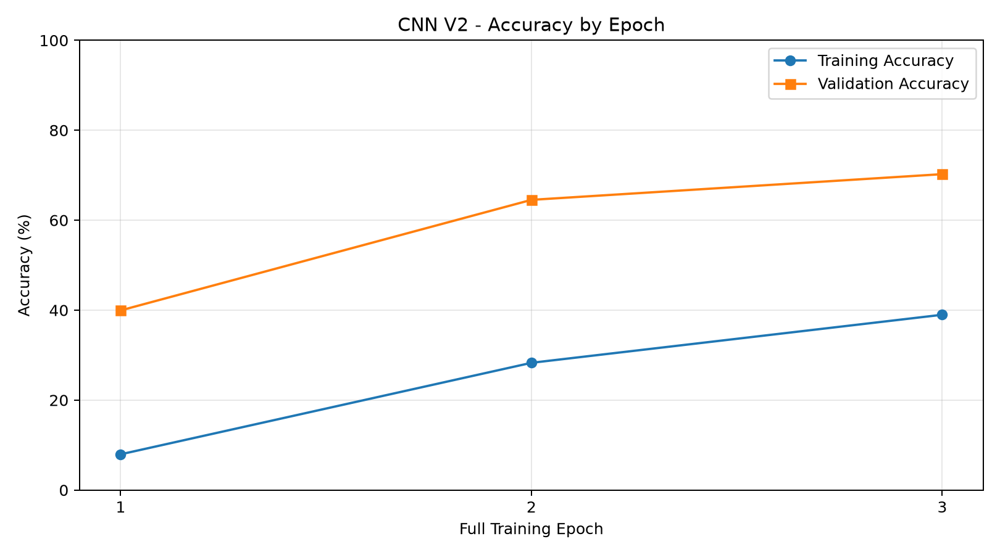
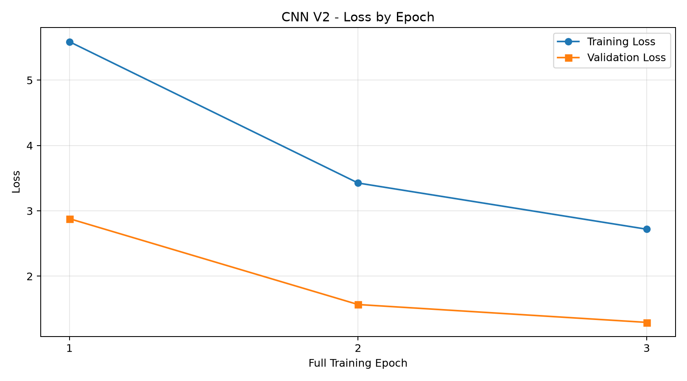
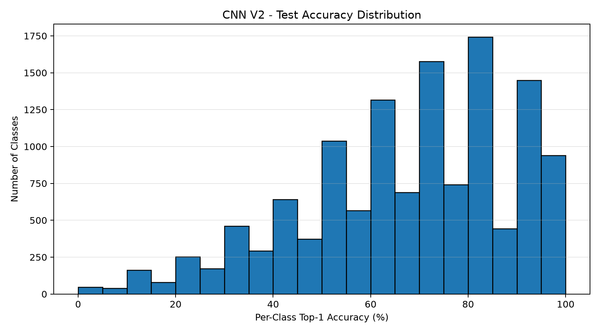
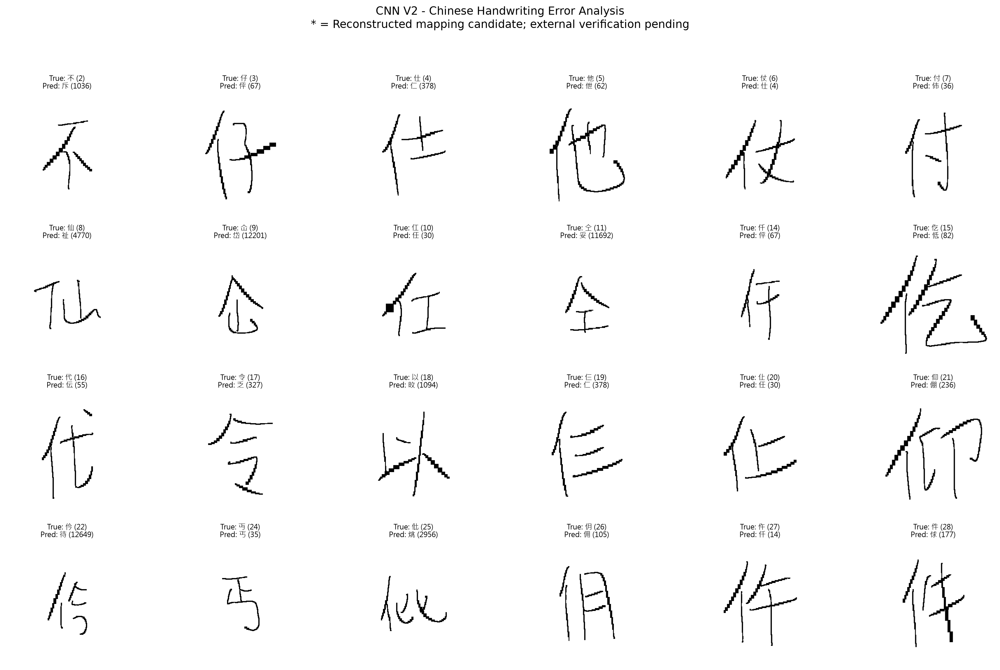

# DIT5411-LUO-Ziming

## Traditional Chinese Handwriting Recognition Using TensorFlow

A machine learning project developed for THEi DIT5411 Machine Learning.

This project uses Convolutional Neural Networks (CNNs) to recognize handwritten Traditional Chinese characters from grayscale images.

The final CNN V2 model has 13,065 output classes and includes a Windows desktop interface for single-character recognition.

## 1. Project Overview

- Language: Python 3.12
- Deep learning framework: TensorFlow / Keras
- Computer vision: OpenCV
- Dataset size: 684,677 images
- Character classes: 13,065
- Input shape: 96 x 96 x 1
- Output classes: 13,065
- Final model: CNN V2
- Final checkpoint: full_13065_v2_full_epoch_003.keras

## 2. Dataset

The project uses a Traditional Chinese handwriting dataset containing 684,677 handwritten character images across 13,065 classes.

The dataset is based on handwritten character data originally associated with the Tegaki ecosystem.

Dataset reference:
https://github.com/AI-FREE-Team/Traditional-Chinese-Handwriting-Dataset

The full source image collection is omitted. The error analysis figure includes selected annotated test samples.

### Data Splitting

Within each class, original images are sorted by the numeric suffix of the upstream filename. The first 40 available images enter the initial training pool, and the remaining images form the assignment test set. A seeded holdout drawn from the training pool provides development validation.

Dataset statistics:

| Dataset component | Images |
|---|---:|
| All original samples | 684,677 |
| Initial training samples | 522,127 |
| Original test samples | 162,550 |
| Development training subset | 417,719 |
| Original validation subset | 104,408 |
| Validation without exact development-training matches | 85,952 |

The original splits have disjoint file paths. An audit of all 684,677 images found 18,456 validation rows (17.68%) with an exact image match in development training, including 18,450 with a same-label match. Sixteen test rows matched development training or validation. All 16 were copies of a white image assigned to different labels across the splits. Hashing the original PNG bytes and the decoded grayscale pixels yielded the same cross-split counts.

The filtered validation subset still covers all 13,065 classes. The original test set covers 13,022 classes. The remaining 43 classes contain fewer than 40 originals and have no test examples. The [content audit summary](results/stage8/content_overlap_summary.json) records exact matches and input hashes. Near-duplicates and writer-level overlap remain unmeasured.

## 3. Image Preprocessing

The CNN accepts grayscale images at 96 x 96 pixels.

The inference implementation uses:

1. Grayscale image decoding.
2. Resize to 96 x 96 using OpenCV INTER_AREA.
3. Normalize pixel values to [0, 1].
4. Invert pixel intensity to represent dark handwriting as high-valued strokes.
5. Add the channel and batch dimensions.

The desktop interface reproduces the saved evaluation predictions for 32 out of 32 checked examples. This is a pipeline compatibility check, not a new accuracy measurement.

## 4. Data Augmentation

The assignment requires at least 200 training examples for every class.

Each full epoch draws 200 items per class, for 2,613,000 training items. These comprise 417,719 originals and 2,195,281 dynamically transformed images. Each class contributes 13 to 32 original items and 168 to 187 transformed items. A blank original can produce pixel-identical transformations, so the item count measures training visits.

The augmentation implementation includes geometric transformations such as:

- Small random rotations
- Scaling
- Shearing

The development configuration uses approximately:

- Rotation: +/-8 degrees
- Scaling: 0.90 to 1.08
- Shearing: +/-0.12

Augmentation is applied to training data, not to the independent test images.

Implementation:
`src/augmentation.py`

## 5. Model Development

Several neural network architectures were examined during development.

### Small Three-Class Pilot Experiments

| Model | Main architecture | Pilot Top-1 |
|---|---|---:|
| MLP V2 | Flatten, Dense(128), Dropout(0.20), Dense(64), 3-class Softmax | 96.97% (32/33) |
| CNN V1 | Conv2D(16/32/48), MaxPooling, Flatten, Dense(64), Dropout(0.25), Softmax | 96.97% (32/33) |
| Improved CNN V1 | Conv2D(16/32/64/96), Batch Normalization, MaxPooling, Global Average Pooling, Dense(64), Dropout(0.30), Softmax | 33.33% (11/33) |
| Improved CNN V2 | Conv2D(16/32/64/96), Layer Normalization, MaxPooling, Flatten, Dense(64), Dropout(0.30), Softmax | 100.00% (33/33) |

The exploratory pilot uses 33 test images from Class 1, Class 1000 and Class 13065. These paths are also included in the full test manifest. Seven of the 24 pilot validation images exactly match pilot training images. [Pilot metrics](results/model_comparison_3class_v3.csv)

The final full-scale CNN V2 uses a separate architecture defined in `src/full_pilot_train.py`: three convolutional layers with 16, 32 and 48 filters, strided downsampling, pooling, a 64-unit dense layer, dropout of 0.20 and a 13,065-unit logits output. It uses Adam with learning rate 0.0003 and sparse categorical cross-entropy from logits.

### Full 13,065-Class CNN V2

The final model is a convolutional neural network with multiple feature extraction layers and a 13,065-unit classification output.

The model contains approximately 978,553 parameters.

The final full-scale model completed one coverage epoch (32 items per class) followed by three full epochs (200 items per class) with dynamic augmentation.

The full-class test comparison includes a small CNN, a pooled MLP and a pooled nearest-centroid classifier.

## 6. Training Results

| Full epoch | Training accuracy | Validation accuracy | Training loss | Validation loss |
|---|---:|---:|---:|---:|
| 1 | 7.95% | 39.95% | 5.5885 | 2.8802 |
| 2 | 28.29% | 64.53% | 3.4261 | 1.5665 |
| 3 | 38.98% | 70.24% | 2.7191 | 1.2931 |

The table records the historical validation results, which included exact image matches with development training. A new evaluation of the final checkpoint on the 85,952 filtered validation images yielded **68.06% Top-1** (58,496 correct), **89.68% Top-5** (77,080 correct) and **68.12% macro class accuracy** across all 13,065 classes. The Top-1 difference of 2.19 percentage points describes the change in evaluation cohort.

### Training Accuracy



### Training Loss



## 7. Original Test Results

All four models were evaluated on the original assignment split of 162,550 test images covering 13,022 classes. They use the same grayscale input normalization, class IDs and evaluator. The split includes the 16 white images identified in the content audit.

| Model | Training budget | Top-1 | Top-5 | Macro class accuracy |
|---|---|---:|---:|---:|
| CNN V2 | 1 coverage epoch + 3 full epochs | 67.05% | 88.84% | 67.18% |
| Small CNN | 1 full epoch | 5.94% | 15.92% | 6.19% |
| Pooled MLP | 1 full epoch | 4.37% | 12.00% | 4.51% |
| Pooled nearest centroid | 1 analytic fit | 5.89% | 13.62% | 6.05% |

CNN V2 had the highest measured test accuracy and is the checkpoint used by the demo. The full test rerun reproduced the historical counts of 108,994 Top-1 and 144,406 Top-5 hits. [Full-class metrics and input hashes](results/stage8/full_class_comparison.json)

Each full epoch or analytic fit uses 200 training items per class, including originals. The final CNN augments original-resolution images. The neural baselines use affine augmentation after pooling to 32×32, and the centroid baseline applies its affine transforms after pooling to 12×12. The measured differences reflect the training recipes and budgets as well as the model designs.

Macro class accuracy is the unweighted mean of the per-class Top-1 accuracies for classes with test samples.

As a sensitivity check, the 16 overlapping white images were re-inferred with the same checkpoint. All 16 missed both Top-1 and Top-5. Subtracting these rows from the historical results yields Top-1 67.0592%, Top-5 88.8466% and macro class accuracy 67.1899% on 162,534 images. This calculation uses the historical totals and the targeted rerun.

The three-class pilot results and full-scale test results represent different classification tasks and are not directly comparable.

### Per-Class Accuracy Distribution



### Recognition Error Analysis



The figure displays selected test samples from the attributed dataset, resized for display and annotated with class labels, predictions and ranks. It illustrates individual errors from the saved error sample.

## 8. Traditional Chinese Character Mapping

The original ZIP filename bytes were examined to recover character labels.

The recovered mapping contains one candidate character for every class:

| Mapping evidence | Number of classes |
|---|---:|
| Directly consistent encoding | 12,978 |
| Reconstructed filename candidate | 85 |
| Visually supported special candidate | 2 |
| Total | 13,065 |

The mapping is reconstructed and has not been fully checked against an authoritative original label dictionary.

The two special cases are:

- Class 2781: 濈
- Class 12332: 嶒

Their original filenames contain unexplained additional ASCII bytes. These remain visually supported candidates, not independently verified original labels.

Mapping file:
`results/stage9/character_mapping_for_demo.csv`

## 9. Desktop Recognition Demo

A Tkinter desktop application allows users to select a single-character image and display:

- Predicted Traditional Chinese character
- Predicted class ID
- Top-5 character candidates
- Model scores
- Mapping evidence status

### Run the Demo

Use 64-bit Python 3.12 with Tcl/Tk on Windows. Open PowerShell in a directory where you want the checkout.

```powershell
git clone https://github.com/miosi87264098-blip/DIT5411-LUO-Ziming.git
Set-Location DIT5411-LUO-Ziming
python --version
python -m venv .venv
.\.venv\Scripts\python.exe -m pip install -r requirements.txt
.\.venv\Scripts\python.exe src\handwriting_demo.py
```

The application loads the final CNN V2 checkpoint from `models/` and the character mapping from `results/stage9/`.

### Standalone Demo Compatibility

The public repository includes the final trained checkpoint and the reconstructed class-to-character mapping.

With at least 12 distinct readable reference images, the application checks preprocessing against cached predictions. With fewer references or no cache, it uses the validated `area_inverted` configuration. In both cases it checks the model shape and class mapping before opening the interface.

Users can select their own single-character handwriting images through the Tkinter interface.

### Five Manually Selected Demo Examples

| True character | Top-1 prediction | Model score | True-label rank |
|---|---|---:|---:|
| 不 | 不 | 63.18% | 1 |
| 他 | 佗 | 35.08% | 2 |
| 仙 | 仙 | 99.11% | 1 |
| 佢 | 佢 | 70.52% | 1 |
| 濈 | 激 | 43.99% | 2 |

These five manually selected examples are illustrative functional tests, not a statistically representative evaluation.

## 10. Limitations

1. Recognition accuracy varies substantially between character classes.
2. Only 13,022 of 13,065 classes have independent test samples.
3. Some label mappings required byte reconstruction or visual interpretation.
4. The demo is designed for images containing one handwritten character.
5. Large whitespace, unusual backgrounds and different handwriting styles may reduce performance.
6. Development pilot accuracies cannot be directly compared with the full 13,065-class results.
7. Training budgets and augmentation stages differ between the final CNN and the baselines.
8. The original validation metrics include exact content matches with development training. The filtered validation split removes those matches.

## 11. References

1. THEi, DIT5411 Machine Learning Assignment (Character Recognition), 2026.
2. Traditional Chinese Handwriting Dataset:
   https://github.com/AI-FREE-Team/Traditional-Chinese-Handwriting-Dataset
3. OpenCV augmentation reference:
   https://github.com/darshitajain/Introduction-to-OpenCV
4. Keras and TensorFlow example:
   https://github.com/kimanalytics/Handwritten-Digit-Recognition-using-Keras-and-TensorFlow
5. TensorFlow:
   https://www.tensorflow.org/
6. OpenCV:
   https://opencv.org/

## 12. Reproducibility and Data Availability

The repository includes model source code, evaluation summaries, figures and the selected final trained checkpoint.

To reconstruct the original split, obtain `all_data.zip.001` through `all_data.zip.012` from the [complete dataset repository](https://github.com/chenkenanalytic/handwritting_data_all) and place them in `data/raw/handwritting_data_all/`. Run the following from the project root using the virtual environment created above. These scripts generate local data and split manifests.

```powershell
$python = '.\.venv\Scripts\python.exe'
& $python src\merge_dataset.py
& $python src\extract_dataset.py
& $python src\analyze_dataset.py
& $python src\split_dataset.py
& $python src\prepare_full_split.py
```

### Audit the Original Splits

The audit writes a summary and filtered manifests to a separate directory. Add `--grayscale` to compare decoded grayscale pixels as well as PNG bytes.

```powershell
$python = '.\.venv\Scripts\python.exe'
& $python src\audit_image_overlap.py --dataset-root . --output-dir .tmp\content-audit
$validation = '.tmp\content-audit\archive_png_bytes_nonoverlap_validation.csv'
& $python src\evaluate_full_13065.py --split validation --manifest $validation --expected-images 85952 --output-dir .tmp\cnn-v2-validation
```

### Train and Compare Full-Class Neural Models

The shallow MLP averages the 96×96 input to 32×32, flattens it and passes it through a dense hidden layer. The small CNN places two spatial convolution layers and max pooling between the initial average pooling and its dense hidden layer. Both models produce 13,065 logits. Each full epoch uses the same development training paths and 200 items per class. The best epoch is chosen on the validation manifest supplied to the run.

```powershell
$python = '.\.venv\Scripts\python.exe'
$validation = '.tmp\content-audit\archive_png_bytes_nonoverlap_validation.csv'
$archive = 'data\raw\handwritting_data_all\all_data.zip'
& $python src\train_full_baseline.py --architecture mlp --validation-manifest $validation --output-dir .tmp\full-mlp --epochs 1 --cache-dir .tmp\pooled-cache --batch-size 512 --threads 8
& $python src\evaluate_full_13065.py --split test --checkpoint .tmp\full-mlp\best.keras --archive $archive --batch-size 256 --workers 4 --output-dir .tmp\full-mlp-test
```

Use `--architecture cnn` with new output directories for the small CNN. The optional archive cache pools the inputs before augmentation and uses batched TensorFlow affine transforms. A run without `--cache-dir` uses the original augmentation order and can take substantially longer on a CPU. Each evaluation marks its split and records manifest and checkpoint SHA-256 values. It writes metrics, per-class counts and a small error sample.

### Fit the Pooled Nearest-Centroid Baseline

This baseline averages the 96×96 input to 12×12, creates the remaining training items by applying seeded affine transforms up to 200 per class, and estimates one mean feature vector per class. A Keras dense output layer ranks classes by squared distance to these fitted means.

```powershell
$python = '.\.venv\Scripts\python.exe'
$archive = 'data\raw\handwritting_data_all\all_data.zip'
& $python src\fit_full_centroid_baseline.py --dataset-root . --output-dir .tmp\full-centroid
& $python src\evaluate_full_13065.py --split test --checkpoint .tmp\full-centroid\full_pooled_nearest_centroid.keras --archive $archive --batch-size 256 --workers 4 --output-dir .tmp\full-centroid-test
```

Use the same original 162,550 rows for the assignment test comparison. The separately filtered test manifest supports sensitivity checks.

## Dataset Attribution and Licensing

The handwritten character dataset is credited to AI . FREE Team and Po-Chuan Chen (2020), *Traditional Chinese Handwriting Dataset*.

Source repository:
https://github.com/AI-FREE-Team/Traditional-Chinese-Handwriting-Dataset

Complete dataset repository:
https://github.com/chenkenanalytic/handwritting_data_all

The source dataset was adapted from [STUST EECS Chinese MNIST](https://scidm.nchc.org.tw/dataset/stusteecs_chinese_mnist), provided by the Department of Electrical Engineering and Computer Science at Southern Taiwan University of Science and Technology. The original dataset page lists CC BY-NC 4.0.

The complete dataset distribution README specifies [CC BY-NC-SA 4.0](https://creativecommons.org/licenses/by-nc-sa/4.0/) for the dataset. The related AI . FREE Team repository has a separate [CC BY-SA 4.0 license file](https://github.com/AI-FREE-Team/Traditional-Chinese-Handwriting-Dataset/blob/master/License).

The full collection is omitted. The annotated error analysis figure contains selected test images from the attributed dataset. The model checkpoint and recovered labels were produced using this dataset. Check the applicable terms before redistributing these materials or using them commercially.

## Source Code License

The [MIT License](src/LICENSE) applies only to original Python source in `src/` that LUO Ziming has the right to license. Third-party materials follow their applicable terms. See [Dataset Attribution and Licensing](#dataset-attribution-and-licensing) for the dataset, trained model checkpoint, recovered character mappings, and figures.

## Author

LUO Ziming

THEi - DIT5411 Machine Learning

Academic Year 2026/27
