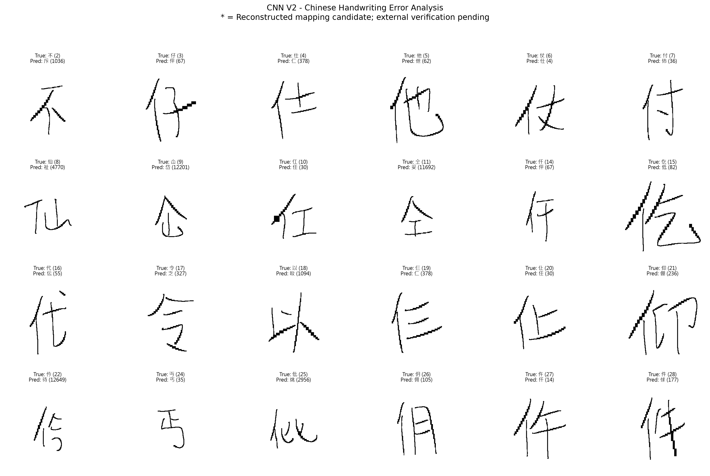

# CNN V2 - Error Analysis

## Final Test Results

- Test images: 162,550
- Tested classes: 13,022
- Top-1 Accuracy: 67.05%
- Top-5 Accuracy: 88.84%
- Macro Class Accuracy: 67.18%

## Per-Class Performance

- Classes below 30% accuracy: 754
- Classes at or above 80% accuracy: 4574
- Classes with zero correct predictions: 48

## Twenty Most Difficult Tested Classes

| Class ID | Test Images | Correct | Accuracy |
|---|---:|---:|---:|
| 8276 | 20 | 0 | 0.00% |
| 8459 | 20 | 0 | 0.00% |
| 9083 | 19 | 0 | 0.00% |
| 9118 | 19 | 0 | 0.00% |
| 9313 | 19 | 0 | 0.00% |
| 10326 | 18 | 0 | 0.00% |
| 10587 | 18 | 0 | 0.00% |
| 10599 | 18 | 0 | 0.00% |
| 10600 | 18 | 0 | 0.00% |
| 10612 | 18 | 0 | 0.00% |
| 10755 | 17 | 0 | 0.00% |
| 10782 | 17 | 0 | 0.00% |
| 1691 | 12 | 0 | 0.00% |
| 997 | 11 | 0 | 0.00% |
| 1116 | 11 | 0 | 0.00% |
| 2214 | 11 | 0 | 0.00% |
| 1271 | 10 | 0 | 0.00% |
| 1349 | 10 | 0 | 0.00% |
| 1384 | 10 | 0 | 0.00% |
| 4156 | 10 | 0 | 0.00% |

## Common Confusions

| True Class | Predicted Class | Errors |
|---|---|---:|
| 10782 | 10781 | 16 |
| 8459 | 8472 | 14 |
| 10326 | 10328 | 14 |
| 7419 | 4821 | 12 |
| 7432 | 4828 | 12 |
| 10302 | 10305 | 12 |
| 10331 | 10328 | 12 |
| 10768 | 10677 | 12 |
| 10804 | 10799 | 12 |
| 7409 | 4811 | 11 |
| 10671 | 10676 | 11 |
| 10700 | 7680 | 11 |
| 1691 | 4927 | 10 |
| 7465 | 4838 | 10 |
| 7700 | 7699 | 10 |
| 9713 | 6495 | 10 |
| 10238 | 10512 | 10 |
| 10526 | 7683 | 10 |
| 10576 | 10558 | 10 |
| 10729 | 10693 | 10 |

## Error Examples

Image source: [Traditional Chinese Handwriting Dataset](../../README.md#dataset-attribution-and-licensing). Selected original test samples are resized for the figure and annotated with their labels and predictions.

The saved error-example CSV contains only
up to the first 200 errors encountered.
The montage is illustrative, not a random
or representative sample of all errors.

## Interpretation

The CNN achieves higher Top-5 than Top-1
accuracy, suggesting that a candidate-ranking
interface could be useful.

Per-class accuracy varies substantially.
Specific causes, such as visually similar
characters, require character-label
verification before they can be confirmed.

## Limitations

- 43 classes have no independent test examples.
- Class-ID-to-character mapping is not yet verified.
- Error examples are a small, biased subset.
- Path-level splitting does not prove the absence
  of image-content duplicates.

See the [mapping quality report](../stage9/mapping_quality_report.md) for the label audit.
