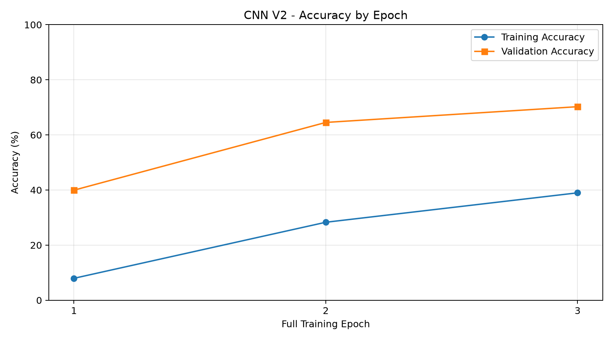
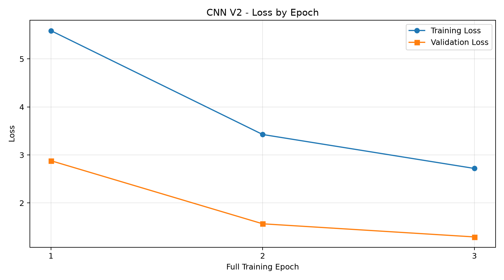
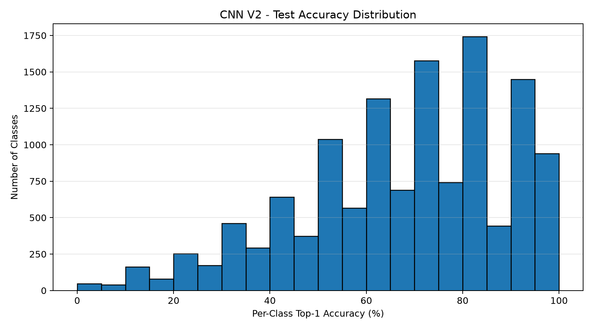

# DIT5411 - Final Machine Learning Results

## Dataset

- Output classes: 13,065
- Original training candidates: 522,127
- Final training originals: 417,719
- Validation images: 104,408
- Independent test images: 162,550
- Classes with test samples: 13,022
- Classes without test samples: 43
- Target augmented training samples per epoch: 2,613,000

## Model

- Model: CNN V2
- Parameters: 978,553
- Input shape: 96 x 96 x 1
- Output logits: 13,065
- Completed Full Epochs: 3
- Final checkpoint: full_13065_v2_full_epoch_003.keras

## Full Training History

| Epoch | Train Acc. | Val Acc. | Train Loss | Val Loss |
|---|---:|---:|---:|---:|
| 1 | 7.95% | 39.95% | 5.5885 | 2.8802 |
| 2 | 28.29% | 64.53% | 3.4261 | 1.5665 |
| 3 | 38.98% | 70.24% | 2.7191 | 1.2931 |

## Independent Test Results

- Top-1 Accuracy: 67.05%
- Top-5 Accuracy: 88.84%
- Macro Class Accuracy: 67.18%
- Best completed validation epoch: 3
- Test duration: 26.64 minutes

## Limitations

- The 43 rare categories have no held-out test examples.
- Class-ID to actual Chinese-character mapping still requires verification.
- Three-class MLP/CNN experiments are not equivalent to full-class benchmarking.
- Dataset path-disjointness was checked, but content-level duplicate detection was not established.
- Test results should not be used repeatedly for hyperparameter selection.

## Generated Figures

